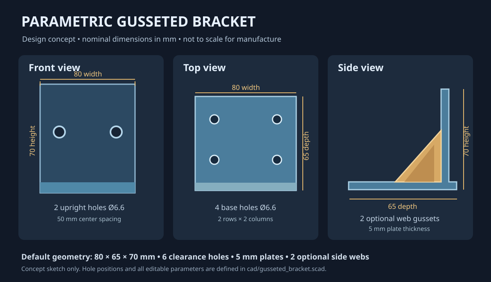

# Parametric Gusseted Mounting Bracket



**[Editable OpenSCAD model](cad/gusseted_bracket.scad)** · **[Concept drawing](docs/bracket-concept.svg)** · **[Validation script](tests/validate_design.py)**

An independently customized, parameter-driven **right-angle mounting bracket** design in OpenSCAD. It has four base mounting holes, two upright mounting holes and two optional triangular reinforcement webs. The intended learning goals are parametric modeling, geometric constraints, feature placement and repeatable digital mesh inspection.

**Status:** digital CAD demonstration only. The design is **not** fabricated, physically load-tested, structurally certified, tolerance-qualified or suitable for safety-critical applications without proper engineering review.

## Design specification

| Parameter | Default |
| --- | ---: |
| Overall width | 80 mm |
| Base depth | 65 mm |
| Upright height | 70 mm |
| Plate thickness | 5 mm |
| Hole diameter | 6.6 mm (illustrative M6 clearance; not a tolerance specification) |
| Base hole centers | X ±25 mm; Y 17 and 42 mm |
| Upright hole centers | X ±25 mm; Z 46 mm |
| Gussets | 2 optional webs, 4 mm thick, 31 mm reach, 35 mm height |

All geometry is editable in [`cad/gusseted_bracket.scad`](cad/gusseted_bracket.scad) through simple parameters. The drawing above is a **conceptual illustration**, not a formal ASME/ISO production drawing.

## Modifications and original credit

This project takes conceptual inspiration from [Samet Ozer's parametric filleted L-bracket example](https://github.com/scaletr/openscad_md/blob/main/L_bracket/L_bracket_v3.scad), distributed under the MIT license (see [upstream attribution](LICENSE-REFERENCE.txt)). The part here uses **separately rewritten OpenSCAD geometry**:

- Changed the form to wider orthogonal plates with **six holes** instead of a basic two-hole configuration.
- Added **optional triangular side webs** with adjustable reach, rise, thickness and inset.
- Added independent controls for mounting-hole row locations and X-axis spacing.
- Added parameter assertions and a Python-based mesh validation workflow.

The [repository MIT license](LICENSE) covers the repository; upstream notice is preserved separately. This is an attributed CAD adaptation, not original authorship of the reference example.

## Reproduce and edit

Install [OpenSCAD](https://openscad.org/downloads.html), open the `.scad` file, adjust the variables at the top, press **F5** for preview or **F6** for final render. Export a triangulated STL:

```bash
openscad -o exports/gusseted_bracket.stl cad/gusseted_bracket.scad
```

Generate a variant (width 100 mm, hole spacing 65 mm):

```bash
openscad -D 'width=100' -D 'hole_x_spacing=65' -o exports/wider_bracket.stl cad/gusseted_bracket.scad
```

Install the mesh QA library and run the check:

```bash
python3 -m pip install -r requirements.txt
python3 tests/validate_design.py
```

The test **rebuilds** the default STL, then checks its bounds, watertightness, and number of connected solids.

## Validation scope

A previous local prototype built from this CAD design was successfully rendered and checked as a single watertight solid with a bounding box of **80 × 65 × 70 mm**. The source and repeatable validation test are provided here; rebuild and rerun before treating GitHub exports as validated. Geometry checks do **not** establish material strength, allowable loading, fatigue life, fastener bearing, or manufacturing tolerances.

**Next technical milestones:** export and commit regenerated STL/PNG assets, create a fully toleranced drawing, prototype, and document a justified load case.

## Repository contents

- [`cad/gusseted_bracket.scad`](cad/gusseted_bracket.scad) — editable parametric design source
- [`docs/bracket-concept.svg`](docs/bracket-concept.svg) — conceptual three-view illustration
- [`tests/validate_design.py`](tests/validate_design.py) — mesh verification
- [`requirements.txt`](requirements.txt) — Python dependency
- [`LICENSE-REFERENCE.txt`](LICENSE-REFERENCE.txt) — attributed upstream MIT reference

This is a technical portfolio exercise, not a commercial part specification.
